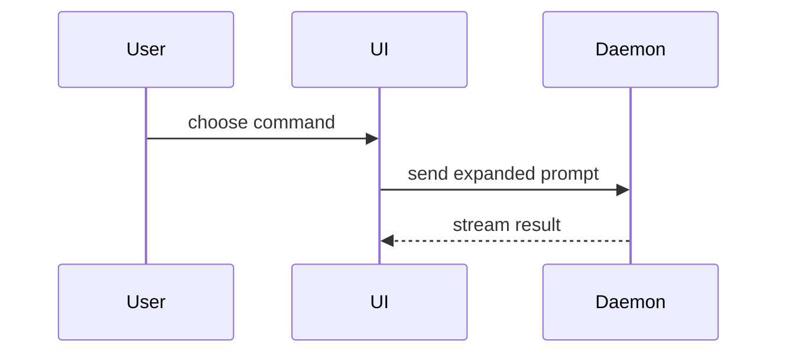

# History, conflict resolution, and PR evidence

These are task-specific patterns. Repository commands, runtime compatibility, task authorization, and the canonical skill control their use. Code blocks are examples to adapt, not instructions to install a framework or run remote operations.

## Merge vs Rebase

### Merge (Preserves History)

```bash
# Creates a merge commit
git checkout main
git merge feature/user-auth

# Result:
# *   merge commit
# |\
# | * feature commits
# |/
# * main commits
```

**Use when:**
- Merging feature branches into `main`
- You want to preserve exact history
- Multiple people worked on the branch
- The branch has been pushed and others may have based work on it

### Rebase (Linear History)

```bash
# Rewrites feature commits onto target branch
git checkout feature/user-auth
git rebase main

# Result:
# * feature commits (rewritten)
# * main commits
```

**Use when:**
- Updating your local feature branch with latest `main`
- You want a linear, clean history
- The branch is local-only (not pushed)
- You're the only one working on the branch

### Rebase Workflow

```bash
# Update feature branch with latest main (before PR)
git checkout feature/user-auth
git fetch origin
git rebase origin/main

# Fix any conflicts
# Tests should still pass

# Force push (only if you're the only contributor)
git push --force-with-lease origin feature/user-auth
```

### When NOT to Rebase

```
# NEVER rebase branches that:
- Have been pushed to a shared repository
- Other people have based work on
- Are protected branches (main, develop)
- Are already merged

# Why: Rebase rewrites history, breaking others' work
```

## Conflict Resolution

### Identify Conflicts

```bash
# Check for conflicts before merge
git checkout main
git merge feature/user-auth --no-commit --no-ff

# If conflicts, Git will show:
# CONFLICT (content): Merge conflict in src/auth/login.ts
# Automatic merge failed; fix conflicts and then commit the result.
```

### Resolve Conflicts

```bash
# See conflicted files
git status

# View conflict markers in file
# <<<<<<< HEAD
# content from main
# =======
# content from feature branch
# >>>>>>> feature/user-auth

# Option 1: Manual resolution
# Edit file, remove markers, keep correct content

# Option 2: Use merge tool
git mergetool

# Option 3: Accept one side
git checkout --ours src/auth/login.ts    # Keep main version
git checkout --theirs src/auth/login.ts  # Keep feature version

# After resolving, stage and commit
git add src/auth/login.ts
git commit
```

### Conflict Prevention Strategies

```bash
# 1. Keep feature branches small and short-lived
# 2. Rebase frequently onto main
git checkout feature/user-auth
git fetch origin
git rebase origin/main

# 3. Communicate with team about touching shared files
# 4. Use feature flags instead of long-lived branches
# 5. Review and merge PRs promptly
```

### Summary

Pick the smallest view that makes the key point clear.

- Show logic or an algorithm as pseudocode:

```text
on(save)
  if content is unchanged
    return cached result
  write new content
  return fresh result
```

- Show runtime control flow as a call tree:

```text
submitForm
  createSession
    persistPrompt
    launchAgent
  navigateToSession
```

- Show UI structure as a component tree, including state and module boundaries that matter:

```text
<SessionPage> (apps/example/src/routes/session.tsx)
  useSessionEvents()
  <SessionToolbar>
    <RunSkillButton> (packages/ui)
```

- Show file responsibility or a broad refactor as a shallow file tree:

```text
src/
├── commands/       # parses user actions
├── sessions/       # owns session state
└── transport/      # sends API requests
```

- Show component interaction, control flow, or data flow with Mermaid:



- Use `diff` when the point is what changes and the surrounding shape already exists. Match the diff shape to the topic.

For a component change:

```diff
 <SessionPage>
   useSessionEvents()
   <SessionToolbar>
+    <RunSkillButton />
   <SessionTimeline>
+    <SkillResultCard />
```

For a file-layout change:

```diff
 src/
 ├── commands/
+│   └── show-me.ts       # expands the slash command
 ├── sessions/
-└── transport.ts
+└── transport/
+    ├── client.ts
+    └── stream.ts
```

For a call-tree or call-stack change:

```diff
 submitForm
   createSession
     persistPrompt
+    expandSkillMention
     launchAgent
-  navigateToSession
+  navigateToSession
+    subscribeToEvents
```

For a state or control-flow change:

```diff
 on(save)
-  write content
+  if content is unchanged
+    return cached result
+  write new content
+  invalidate cache
```

- Show the whole block when most of it is new, when omitted context would hide ownership or order, or when the user needs a copyable target shape:

```ts
function expandSkill(command: string): string {
  const skillName = command.slice(1);
  return `use the ${skillName} skill`;
}
```

#### Guidance

Place each visual next to the short text it supports. Keep only the calls, files, props, states, and boundaries needed to answer the user's current question or the options to resolve the current discussion point.

You may use one of these, you may use several, it is unlikely you will use all of them. Use your judgement and don't overwhelm the user.

### Evidence

Concrete evidence that the change works. Show a before and after.

Screenshots are S-tier - when the environment is set up for it and the change is visual.

Execution-based evidence is A-tier. Test results, console output. Show the exact test that now fails and passes, using pseudocode.

Git command blocks describe operations, not permission to rewrite published history or mutate remotes. Use a bounded task worktree for conflict experiments. PR summaries may be plain prose; diagrams are optional and repository templates win.
